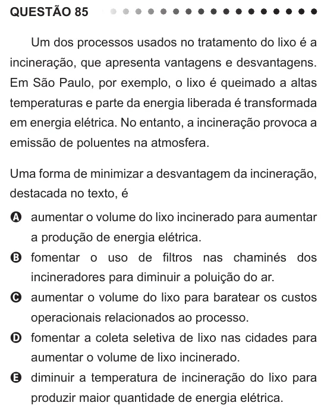

Texto extraído (pode conter ruído)

QUESTÃO 85  
Um dos processos usados no tratamento do lixo é a  
incineração, que apresenta vantagens e desvantagens.  
Em São Paulo, por exemplo, o lixo é queimado a altas  
temperaturas e parte da energia liberada é transformada  
em energia elétrica. No entanto, a incineração provoca a  
emissão de poluentes na atmosfera.  
Uma forma de minimizar a desvantagem da incineração,  
destacada no texto, é  
A aumentar o volume do lixo incinerado para aumentar  
a produção de energia elétrica.  
B fomentar o uso de filtros nas chaminés dos  
incineradores para diminuir a poluição do ar.  
C aumentar o volume do lixo para baratear os custos  
operacionais relacionados ao processo.  
D fomentar a coleta seletiva de lixo nas cidades para  
aumentar o volume de lixo incinerado.  
E diminuir a temperatura de incineração do lixo para  
produzir maior quantidade de energia elétrica.

