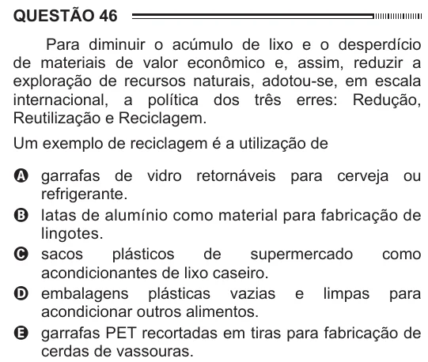

Texto extraído (pode conter ruído)

QUESTÃO 46  
Para diminuir o acúmulo de lixo e o desperdício  
de materiais de valor econômico e, assim, reduzir a  
exploração de recursos naturais, adotou-se, em escala  
internacional, a política dos três erres: Redução,  
Reutilização e Reciclagem.  
Um exemplo de reciclagem é a utilização de  
A garrafas de vidro retornáveis para cerveja ou  
refrigerante.  
B latas de alumínio como material para fabricação de  
lingotes.  
C sacos  
plásticos  
de  
supermercado  
como  
acondicionantes de lixo caseiro.  
D embalagens plásticas vazias e limpas para  
acondicionar outros alimentos.  
E garrafas PET recortadas em tiras para fabricação de  
cerdas de vassouras.

