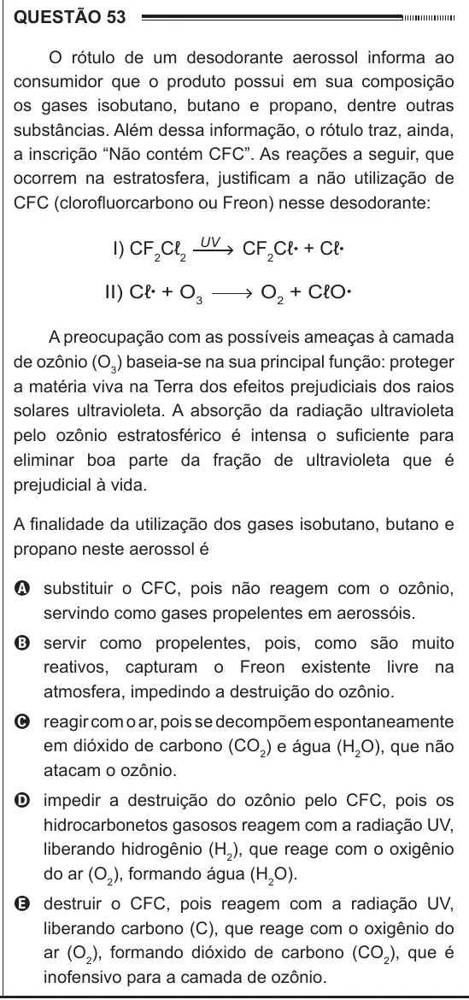

Texto extraído (pode conter ruído)

QUESTÃO 53  
O rótulo de um desodorante aerossol informa ao  
consumidor que o produto possui em sua composição  
os gases isobutano, butano e propano, dentre outras  
substâncias. Além dessa informação, o rótulo traz, ainda,  
a inscrição “Não contém CFC”. As reações a seguir, que  
ocorrem na estratosfera, justificam a não utilização de  
CFC (clorofluorcarbono ou Freon) nesse desodorante:  
I) CF 2 Cℓ 2  
UV  
CF 2 Cℓ • + Cℓ •  
II) Cℓ • + O 3  
O 2 + CℓO •  
A preocupação com as possíveis ameaças à camada  
de ozônio (O 3 ) baseia-se na sua principal função: proteger  
a matéria viva na Terra dos efeitos prejudiciais dos raios  
solares ultravioleta. A absorção da radiação ultravioleta  
pelo ozônio estratosférico é intensa o suficiente para  
eliminar boa parte da fração de ultravioleta que é  
prejudicial à vida.  
A finalidade da utilização dos gases isobutano, butano e  
propano neste aerossol é  
A substituir o CFC, pois não reagem com o ozônio,  
servindo como gases propelentes em aerossóis.  
B servir como propelentes, pois, como são muito  
reativos, capturam o Freon existente livre na  
atmosfera, impedindo a destruição do ozônio.  
C reagir com o ar, pois se decompõem espontaneamente  
em dióxido de carbono (CO 2 ) e água (H 2 O), que não  
atacam o ozônio.  
D impedir a destruição do ozônio pelo CFC, pois os  
hidrocarbonetos gasosos reagem com a radiação UV,  
liberando hidrogênio (H 2 ), que reage com o oxigênio  
do ar (O 2 ), formando água (H 2 O).  
E destruir o CFC, pois reagem com a radiação UV,  
liberando carbono (C), que reage com o oxigênio do  
ar (O 2 ), formando dióxido de carbono (CO 2 ), que é  
inofensivo para a camada de ozônio.

