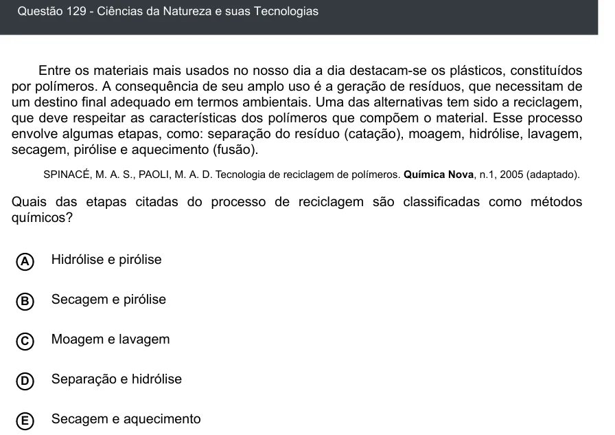

Texto extraído (pode conter ruído)

Questão 129 - Ciências da Natureza e suas Tecnologias  
Entre os materiais mais usados no nosso dia a dia destacam-se os plásticos, constituídos  
por polímeros. A consequência de seu amplo uso é a geração de resíduos, que necessitam de  
um destino final adequado em termos ambientais. Uma das alternativas tem sido a reciclagem,  
que deve respeitar as características dos polímeros que compõem o material. Esse processo  
envolve algumas etapas, como: separação do resíduo (catação), moagem, hidrólise, lavagem,  
secagem, pirólise e aquecimento (fusão).  
SPINACÉ, M. A. S., PAOLI, M. A. D. Tecnologia de reciclagem de polímeros. Química Nova, n.1, 2005 (adaptado).  
Quais das etapas citadas do processo de reciclagem são classificadas como métodos  
químicos?  
A  
Hidrólise e pirólise  
Secagem e pirólise  
B  
Moagem e lavagem  
C  
D  
Separação e hidrólise  
Secagem e aquecimento  
E

