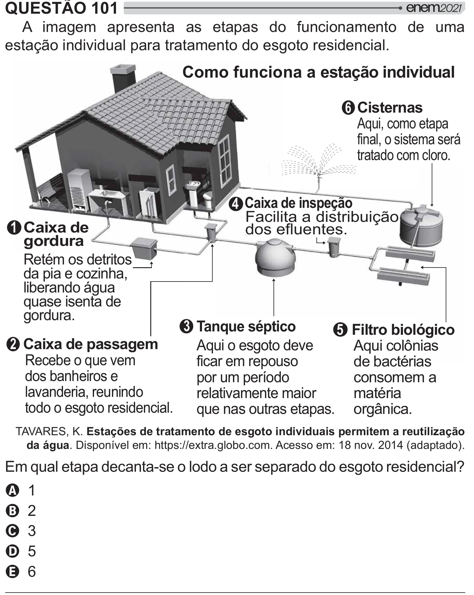

Texto extraído (pode conter ruído)

QUESTÃO 101  
A imagem apresenta as etapas do funcionamento de uma  
estação individual para tratamento do esgoto residencial.  
Como funciona a estação individual  
6 Cisternas  
Aqui, como etapa  
final, o sistema será  
tratado com cloro.  
4 Caixa de inspeção  
Facilita a distribuição  
1 Caixa de  
dos efluentes.  
gordura  
Retém os detritos  
da pia e cozinha,  
liberando água  
quase isenta de  
gordura.  
3 Tanque séptico  
5 Filtro biológico  
2 Caixa de passagem  
Aqui o esgoto deve  
Aqui colônias  
Recebe o que vem  
ficar em repouso  
de bactérias  
dos banheiros e  
por um período  
consomem a  
lavanderia, reunindo  
relativamente maior  
matéria  
todo o esgoto residencial.  
que nas outras etapas. orgânica.  
TAVARES, K. Estações de tratamento de esgoto individuais permitem a reutilização  
da água. Disponível em: https://extra.globo.com. Acesso em: 18 nov. 2014 (adaptado).  
  
 #    
  #    
 ]  
A 1  
B 2  
C 3  
D 5  
E 6

