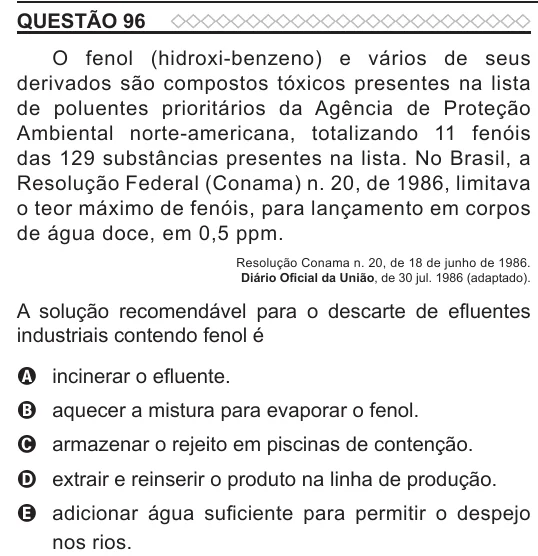

Texto extraído (pode conter ruído)

QUESTÃO 96  
O fenol (hidroxi-benzeno) e vários de seus  
derivados são compostos tóxicos presentes na lista  
de poluentes prioritários da Agência de Proteção  
Ambiental norte-americana, totalizando 11 fenóis  
das 129 substâncias presentes na lista. No Brasil, a  
Resolução Federal (Conama) n. 20, de 1986, limitava  
o teor máximo de fenóis, para lançamento em corpos  
de água doce, em 0,5 ppm.  
Resolução Conama n. 20, de 18 de junho de 1986.  
Diário Oficial da União, de 30 jul. 1986 (adaptado).  
A solução recomendável para o descarte de efluentes  
industriais contendo fenol é  
A incinerar o efluente.  
B aquecer a mistura para evaporar o fenol.  
C armazenar o rejeito em piscinas de contenção.  
D extrair e reinserir o produto na linha de produção.  
E adicionar água suficiente para permitir o despejo  
nos rios.

