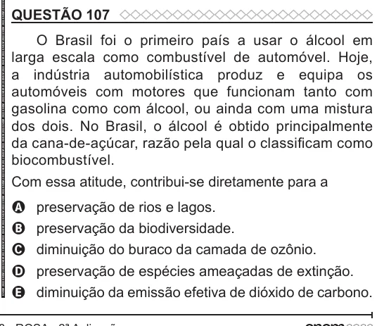

Texto extraído (pode conter ruído)

QUESTÃO 107  
O Brasil foi o primeiro país a usar o álcool em  
larga escala como combustível de automóvel. Hoje,  
a indústria automobilística produz e equipa os  
automóveis com motores que funcionam tanto com  
gasolina como com álcool, ou ainda com uma mistura  
dos dois. No Brasil, o álcool é obtido principalmente  
da cana-de-açúcar, razão pela qual o classificam como  
biocombustível.  
Com essa atitude, contribui-se diretamente para a  
A  
preservação de rios e lagos.  
preservação da biodiversidade.  
B  
diminuição do buraco da camada de ozônio.  
C  
preservação de espécies ameaçadas de extinção.  
D  
diminuição da emissão efetiva de dióxido de carbono.  
E

