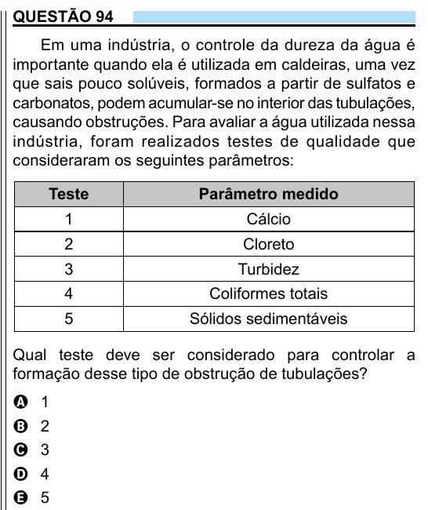

Texto extraído (pode conter ruído)

QUESTÃO 94  
Em uma indústria, o controle da dureza da água é  
importante quando ela é utilizada em caldeiras, uma vez  
que sais pouco solúveis, formados a partir de sulfatos e  
carbonatos, podem acumular-se no interior das tubulações,  
causando obstruções. Para avaliar a água utilizada nessa  
indústria, foram realizados testes de qualidade que  
consideraram os seguintes parâmetros:  
Teste  
Parâmetro medido  
1  
Cálcio  
2  
Cloreto  
3  
Turbidez  
4  
Coliformes totais  
5  
Sólidos sedimentáveis  
Qual teste deve ser considerado para controlar a  
formação desse tipo de obstrução de tubulações?  
1  
A  
2  
B  
3  
C  
4  
D  
5  
E

