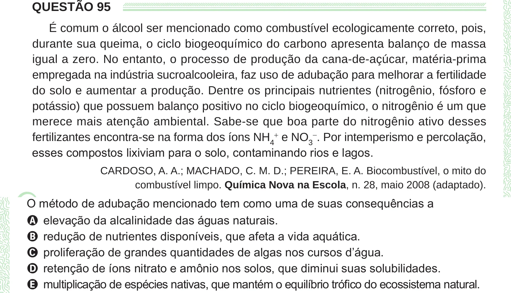

Texto extraído (pode conter ruído)

QUESTÃO 95  
É comum o álcool ser mencionado como combustível ecologicamente correto, pois,  
durante sua queima, o ciclo biogeoquímico do carbono apresenta balanço de massa  
igual a zero. No entanto, o processo de produção da cana-de-açúcar, matéria-prima  
empregada na indústria sucroalcooleira, faz uso de adubação para melhorar a fertilidade  
do solo e aumentar a produção. Dentre os principais nutrientes (nitrogênio, fósforo e  
potássio) que possuem balanço positivo no ciclo biogeoquímico, o nitrogênio é um que  
merece mais atenção ambiental. Sabe-se que boa parte do nitrogênio ativo desses  
fertilizantes encontra-se na forma dos íons NH 4 + e NO 3 − . Por intemperismo e percolação,  
esses compostos lixiviam para o solo, contaminando rios e lagos.  
CARDOSO, A. A.; MACHADO, C. M. D.; PEREIRA, E. A. Biocombustível, o mito do  
combustível limpo. Química Nova na Escola, n. 28, maio 2008 (adaptado).  
A elevação da alcalinidade das águas naturais.  
B redução de nutrientes disponíveis, que afeta a vida aquática.  
C proliferação de grandes quantidades de algas nos cursos d’água.  
D retenção de íons nitrato e amônio nos solos, que diminui suas solubilidades.  
E multiplicação de espécies nativas, que mantém o equilíbrio trófico do ecossistema natural.

