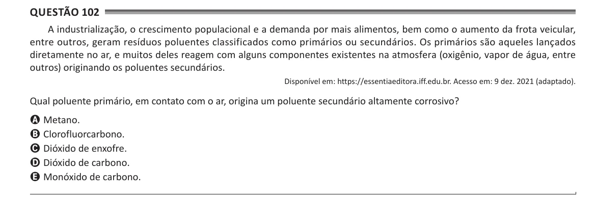

Texto extraído (pode conter ruído)

Questão 102  
A industrialização, o crescimento populacional e a demanda por mais alimentos, bem como o aumento da frota veicular,  
entre outros, geram resíduos poluentes classificados como primários ou secundários. Os primários são aqueles lançados  
diretamente no ar, e muitos deles reagem com alguns componentes existentes na atmosfera (oxigênio, vapor de água, entre  
outros) originando os poluentes secundários.  
Disponível em: https://essentiaeditora.iff.edu.br. Acesso em: 9 dez. 2021 (adaptado).  
Qual poluente primário, em contato com o ar, origina um poluente secundário altamente corrosivo?  
A Metano.  
B Clorofluorcarbono.  
C Dióxido de enxofre.  
D Dióxido de carbono.  
E Monóxido de carbono.

