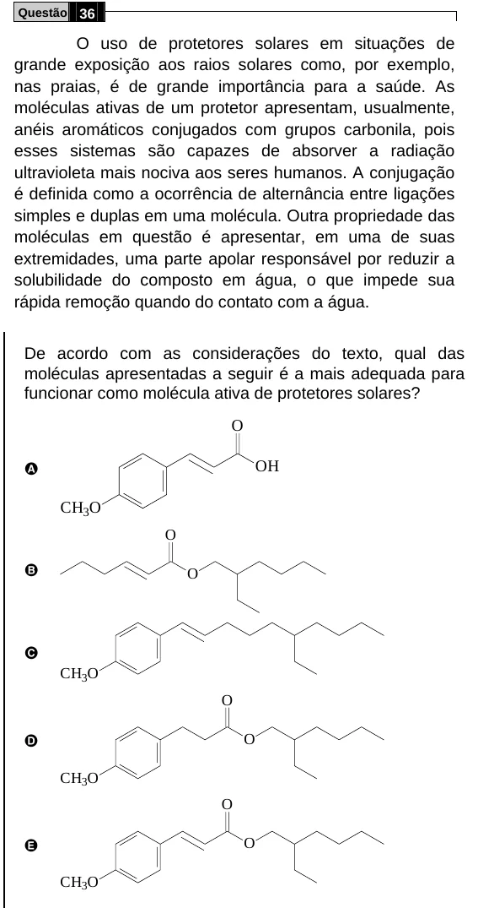

Texto extraído (pode conter ruído)

Questão 36  
O uso de protetores solares em situações de  
grande exposição aos raios solares como, por exemplo,  
nas praias, é de grande importância para a saúde. As  
moléculas ativas de um protetor apresentam, usualmente,  
anéis aromáticos conjugados com grupos carbonila, pois  
esses sistemas são capazes de absorver a radiação  
ultravioleta mais nociva aos seres humanos. A conjugação  
é definida como a ocorrência de alternância entre ligações  
simples e duplas em uma molécula. Outra propriedade das  
moléculas em questão é apresentar, em uma de suas  
extremidades, uma parte apolar responsável por reduzir a  
solubilidade do composto em água, o que impede sua  
rápida remoção quando do contato com a água.  
De acordo com as considerações do texto, qual das  
moléculas apresentadas a seguir é a mais adequada para  
funcionar como molécula ativa de protetores solares?  
O  
OH  
A  
CH 3 O  
O  
B  
O  
C  
CH 3 O  
O  
D  
O  
CH 3 O  
O  
E  
O  
CH 3 O

