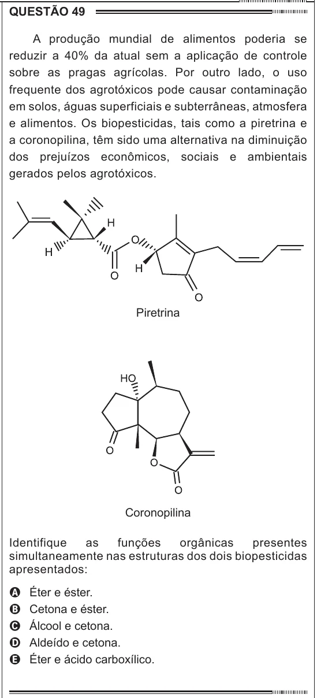

Texto extraído (pode conter ruído)

A produção mundial de alimentos poderia se  
reduzir a 40% da atual sem a aplicação de controle  
sobre as pragas agrícolas. Por outro lado, o uso  
frequente dos agrotóxicos pode causar contaminação  
em solos, águas superficiais e subterrâneas, atmosfera  
e alimentos. Os biopesticidas, tais como a piretrina e  
a coronopilina, têm sido uma alternativa na diminuição  
dos prejuízos econômicos, sociais e ambientais  
gerados pelos agrotóxicos.  
Piretrina  
Coronopilina  
Identifique  
as  
funções  
orgânicas  
presentes  
simultaneamente nas estruturas dos dois biopesticidas  
apresentados:  
Éter e éster.  
A  
B  
Cetona e éster.  
Álcool e cetona.  
C  
Aldeído e cetona.  
D  
Éter e ácido carboxílico.  
E

