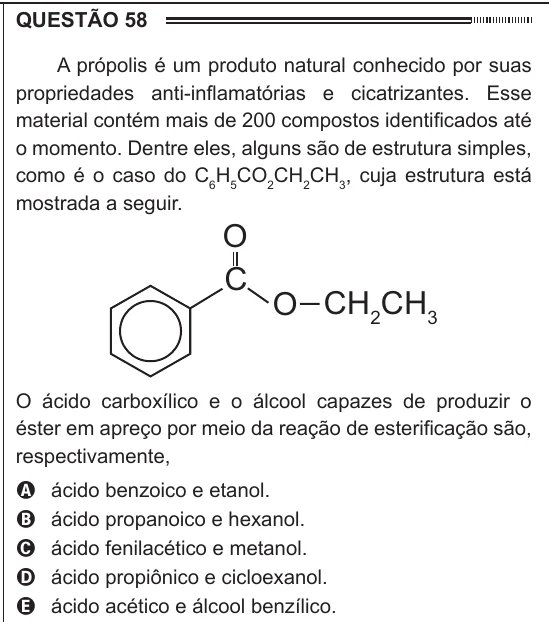

Texto extraído (pode conter ruído)

QUESTÃO 58  
A própolis é um produto natural conhecido por suas  
propriedades anti-inflamatórias e cicatrizantes. Esse  
material contém mais de 200 compostos identificados até  
o momento. Dentre eles, alguns são de estrutura simples,  
como é o caso do C 6 H 5 CO 2 CH 2 CH 3 , cuja estrutura está  
mostrada a seguir.  
O  
C  
O CH 2 CH 3  
O ácido carboxílico e o álcool capazes de produzir o  
éster em apreço por meio da reação de esterificação são,  
respectivamente,  
ácido benzoico e etanol.  
A  
ácido propanoico e hexanol.  
B  
C  
ácido fenilacético e metanol.  
ácido propiônico e cicloexanol.  
D  
ácido acético e álcool benzílico.  
E

