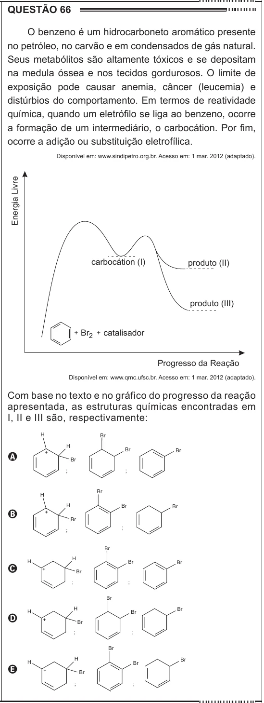

Texto extraído (pode conter ruído)

QUESTÃO 66  
O benzeno é um hidrocarboneto aromático presente  
no petróleo, no carvão e em condensados de gás natural.  
Seus metabólitos são altamente tóxicos e se depositam  
na medula óssea e nos tecidos gordurosos. O limite de  
exposição pode causar anemia, câncer (leucemia) e  
distúrbios do comportamento. Em termos de reatividade  
química, quando um eletrófilo se liga ao benzeno, ocorre  
a formação de um intermediário, o carbocátion. Por fim,  
ocorre a adição ou substituição eletrofílica.  
Disponível em: www.sindipetro.org.br. Acesso em: 1 mar. 2012 (adaptado).  
Energia Livre  
carbocátion (I)  
produto (II)  
produto (III)  
+ Br 2 + catalisador  
Progresso da Reação  
Disponível em: www.qmc.ufsc.br. Acesso em: 1 mar. 2012 (adaptado).  
Com base no texto e no gráfico do progresso da reação  
apresentada, as estruturas químicas encontradas em  
I, II e III são, respectivamente:  
H  
Br  
H  
Br  
Br  
A  
+  
Br  
;  
;  
Br  
H  
H  
Br  
Br  
B  
+  
Br  
;  
;  
Br  
H  
H  
Br  
Br  
C  
+  
Br  
;  
;  
Br  
H  
H  
Br  
Br  
D  
+  
Br  
;  
;  
Br  
H  
Br  
H  
Br  
E  
+  
Br  
;  
;

