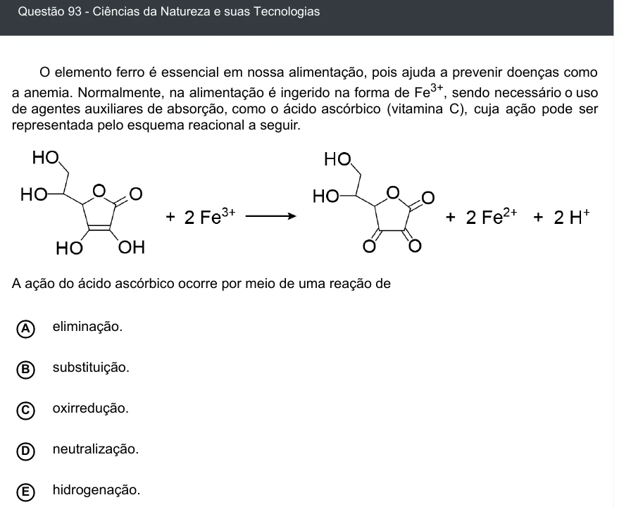

Texto extraído (pode conter ruído)

Questão 93 - Ciências da Natureza e suas Tecnologias  
O elemento ferro é essencial em nossa alimentação, pois ajuda a prevenir doenças como  
a anemia. Normalmente, na alimentação é ingerido na forma de Fe 3+ , sendo necessário o uso  
de agentes auxiliares de absorção, como o ácido ascórbico (vitamina C), cuja ação pode ser  
representada pelo esquema reacional a seguir.  
A ação do ácido ascórbico ocorre por meio de uma reação de  
A  
eliminação.  
substituição.  
B  
oxirredução.  
C  
neutralização.  
D  
E  
hidrogenação.

