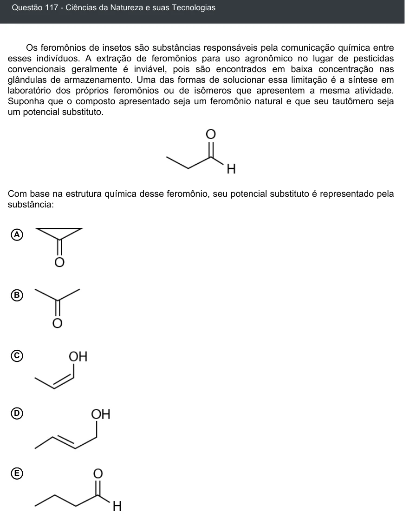

Texto extraído (pode conter ruído)

Questão 117 - Ciências da Natureza e suas Tecnologias  
Os feromônios de insetos são substâncias responsáveis pela comunicação química entre  
esses indivíduos. A extração de feromônios para uso agronômico no lugar de pesticidas  
convencionais geralmente é inviável, pois são encontrados em baixa concentração nas  
glândulas de armazenamento. Uma das formas de solucionar essa limitação é a síntese em  
laboratório dos próprios feromônios ou de isômeros que apresentem a mesma atividade.  
Suponha que o composto apresentado seja um feromônio natural e que seu tautômero seja  
um potencial substituto.  
Com base na estrutura química desse feromônio, seu potencial substituto é representado pela  
substância:  
A  
B  
C  
D  
E

