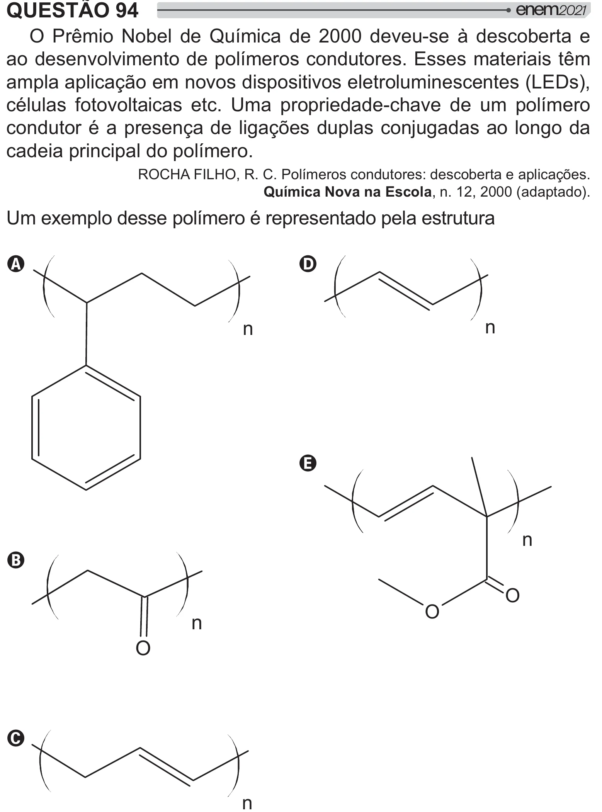

Texto extraído (pode conter ruído)

QUESTÃO 94  
O Prêmio Nobel de Química de 2000 deveu-se à descoberta e  
ao desenvolvimento de polímeros condutores. Esses materiais têm  
ampla aplicação em novos dispositivos eletroluminescentes (LEDs),  
células fotovoltaicas etc. Uma propriedade-chave de um polímero  
condutor é a presença de ligações duplas conjugadas ao longo da  
cadeia principal do polímero.  
ROCHA FILHO, R. C. Polímeros condutores: descoberta e aplicações.  
Química Nova na Escola, n. 12, 2000 (adaptado).  
Um exemplo desse polímero é representado pela estrutura  
A  
D  
n  
n  
E  
n  
B  
O  
O  
n  
O  
C  
n

