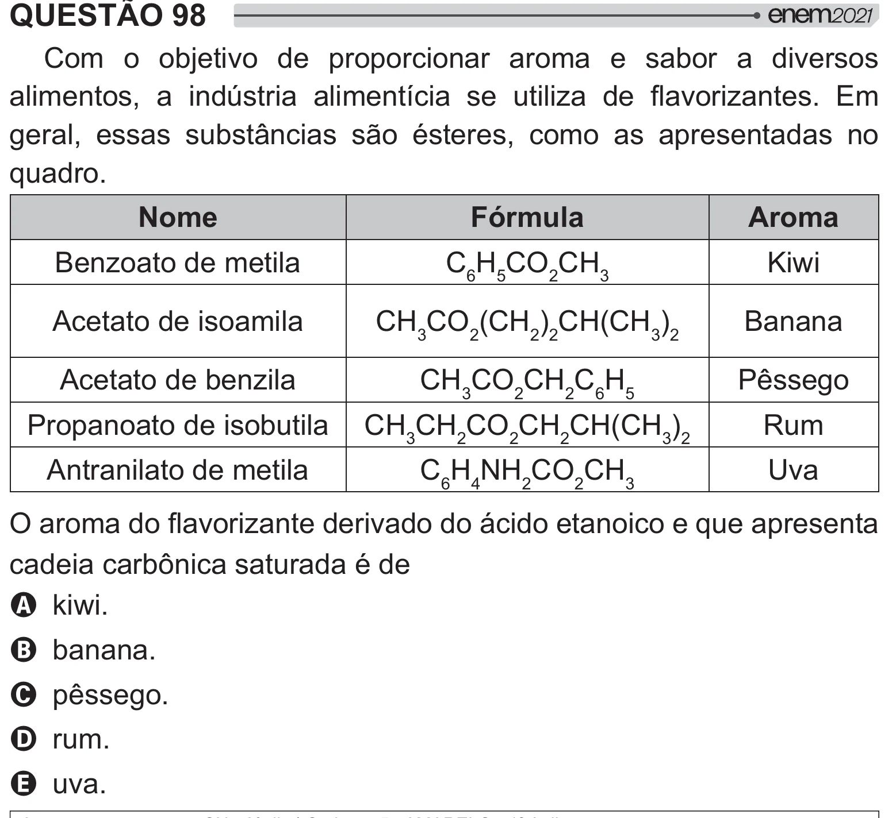

Texto extraído (pode conter ruído)

QUESTÃO 98  
Com o objetivo de proporcionar aroma e sabor a diversos  
     „    {     }" !   
geral, essas substâncias são ésteres, como as apresentadas no  
quadro.  
Nome  
Fórmula  
Aroma  
Benzoato de metila  
C 6 H 5 CO 2 CH 3  
Kiwi  
Acetato de isoamila  
CH 3 CO 2 (CH 2 ) 2 CH(CH 3 ) 2  
Banana  
Acetato de benzila  
CH 3 CO 2 CH 2 C 6 H 5  
Pêssego  
Propanoato de isobutila  
CH 3 CH 2 CO 2 CH 2 CH(CH 3 ) 2  
Rum  
Antranilato de metila  
C 6 H 4 NH 2 CO 2 CH 3  
Uva  
}"  "/    
#  
   
 y2  <  
A kiwi.  
B banana.  
C pêssego.  
D rum.  
E uva.

