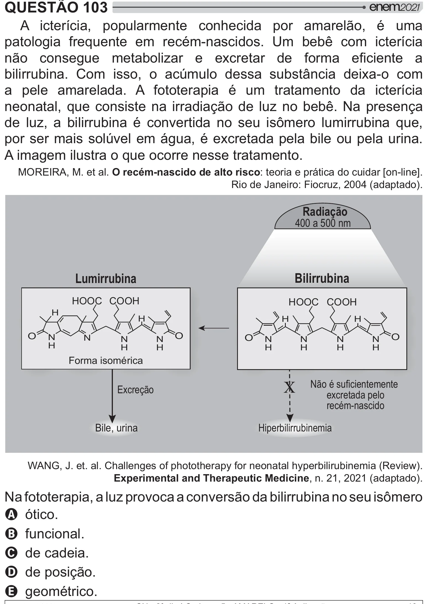

Texto extraído (pode conter ruído)

QUESTÃO 103  
A icterícia, popularmente conhecida por amarelão, é uma  
patologia frequente em recém-nascidos. Um bebê com icterícia  
[     y  *    >      
bilirrubina. Com isso, o acúmulo dessa substância deixa-o com  
a pele amarelada. A fototerapia é um tratamento da icterícia  
neonatal, que consiste na irradiação de luz no bebê. Na presença  
     y y < "     
  2    y  
  
por ser mais solúvel em água, é excretada pela bile ou pela urina.  
A imagem ilustra o que ocorre nesse tratamento.  
MOREIRA, M. et al. O recém-nascido de alto risco: teoria e prática do cuidar [on-line].  
Rio de Janeiro: Fiocruz, 2004 (adaptado).  
Radiação  
400 a 500 nm  
Lumirrubina  
Bilirrubina  
HOOC COOH  
HOOC COOH  
H  
H  
H  
H  
O  
O  
O  
N  
N  
O  
N  
N  
N  
N  
N  
N  
H  
H  
H  
H  
H  
H  
H  
Forma isomérica  
&  
Não é suficientemente  
Excreção  
excretada pelo  
recém-nascido  
Bile, urina  
Hiperbilirrubinemia  
Xˆ^‹! !!$  >#$  $ #@>  $@# y y J " ŒW!  
Experimental and Therapeutic Medicine, n. 21, 2021 (adaptado).  
ˆ>  # #""  [y y  
 2   
A ótico.  
B funcional.  
C de cadeia.  
D de posição.  
E geométrico.

