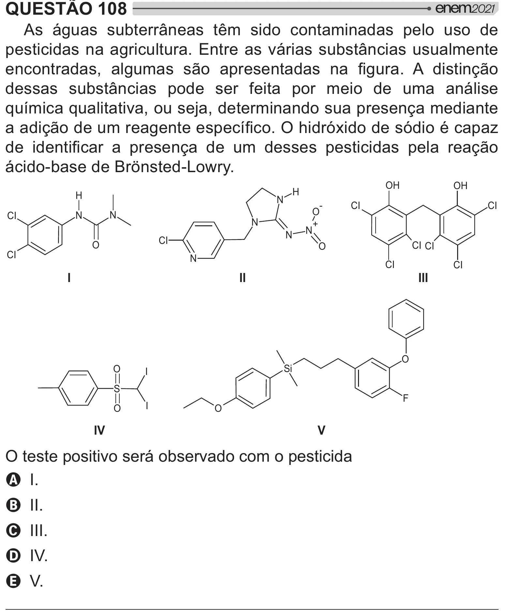

Texto extraído (pode conter ruído)

QUESTÃO 108  
As águas subterrâneas têm sido contaminadas pelo uso de  
pesticidas na agricultura. Entre as várias substâncias usualmente  
      [ #  
     !   =[  
dessas substâncias pode ser feita por meio de uma análise  
química qualitativa, ou seja, determinando sua presença mediante  
=[      # {!$ƒ*  ƒ<#  
      #  
=      
 #   #   =[  
ácido-base de Brönsted-Lowry.  
OH  
OH  
H  
H  
N  
-  
CI  
CI  
O  
N  
N  
CI  
N  
+  
N  
N  
CI  
O  
CI CI  
O  
CI  
N  
CI  
CI  
I  
II  
III  
O  
O  
Si  
I  
S  
F  
I  
O  
O  
IV  
V  
O teste positivo será observado com o pesticida  
A I.  
B II.  
C III.  
D IV.  
E V.

