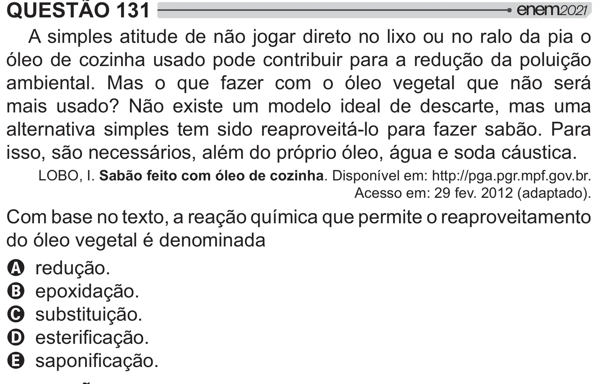

Texto extraído (pode conter ruído)

QUESTÃO 131  
A simples atitude de não jogar direto no lixo ou no ralo da pia o  
óleo de cozinha usado pode contribuir para a redução da poluição  
ambiental. Mas o que fazer com o óleo vegetal que não será  
  ] ˆ[ *                
alternativa simples tem sido reaproveitá-lo para fazer sabão. Para  
isso, são necessários, além do próprio óleo, água e soda cáustica.  
LOBO, I. Sabão feito com óleo de cozinha. Disponível em: http://pga.pgr.mpf.gov.br.  
Acesso em: 29 fev. 2012 (adaptado).  
Com base no texto, a reação química que permite o reaproveitamento  
do óleo vegetal é denominada  
A redução.  
B epoxidação.  
C substituição.  
D   
=[!  
E  #=[!

