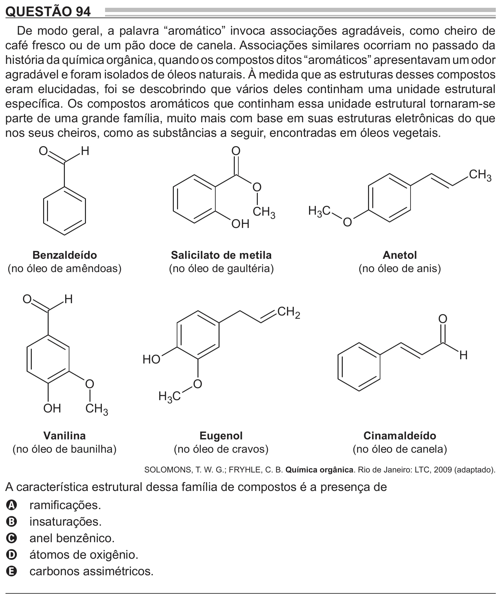

Texto extraído (pode conter ruído)

QUESTÃO 94  
De modo geral, a palavra “aromático” invoca associações agradáveis, como cheiro de  
café fresco ou de um pão doce de canela. Associações similares ocorriam no passado da  
história da química orgânica, quando os compostos ditos “aromáticos” apresentavam um odor  
agradável e foram isolados de óleos naturais. À medida que as estruturas desses compostos  
eram elucidadas, foi se descobrindo que vários deles continham uma unidade estrutural  
específica. Os compostos aromáticos que continham essa unidade estrutural tornaram-se  
parte de uma grande família, muito mais com base em suas estruturas eletrônicas do que  
nos seus cheiros, como as substâncias a seguir, encontradas em óleos vegetais.  
O  
H  
O  
CH 3  
O  
H 3 C  
CH 3  
O  
OH  
Benzaldeído  
Salicilato de metila  
Anetol  
(no óleo de amêndoas)  
(no óleo de gaultéria)  
(no óleo de anis)  
O  
H  
CH 2  
O  
H  
H O  
O  
O  
H 3 C  
OH  
CH 3  
Vanilina  
Eugenol  
Cinamaldeído  
(no óleo de baunilha)  
(no óleo de cravos)  
(no óleo de canela)  
SOLOMONS, T. W. G.; FRYHLE, C. B. Química orgânica. Rio de Janeiro: LTC, 2009 (adaptado).  
A característica estrutural dessa família de compostos é a presença de  
ramificações.  
A  
insaturações.  
B  
anel benzênico.  
C  
átomos de oxigênio.  
D  
carbonos assimétricos.  
E

