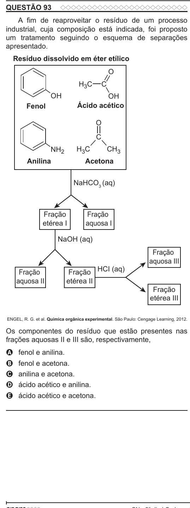

Texto extraído (pode conter ruído)

QUESTÃO 93  
A fim de reaproveitar o resíduo de um processo  
industrial, cuja composição está indicada, foi proposto  
um tratamento seguindo o esquema de separações  
apresentado.  
Resíduo dissolvido em éter etílico  
O  
H 3 C  
C  
OH  
OH  
Fenol  
Ácido acético  
O  
C  
NH 2  
H 3 C  
CH 3  
Anilina  
Acetona  
NaHCO 3 (aq)  
Fração  
Fração  
etérea I  
aquosa I  
NaOH (aq)  
Fração  
aquosa III  
Fração HCI (aq)  
Fração  
aquosa II  
etérea II  
Fração  
etérea III  
ENGEL, R. G. et al. Química orgânica experimental. São Paulo: Cengage Learning, 2012.  
Os componentes do resíduo que estão presentes nas  
frações aquosas II e III são, respectivamente,  
fenol e anilina.  
A  
fenol e acetona.  
B  
anilina e acetona.  
C  
ácido acético e anilina.  
D  
E  
ácido acético e acetona.

