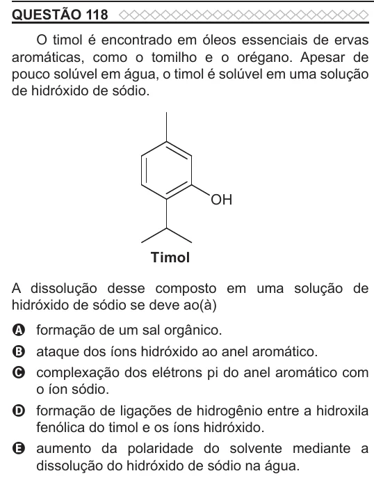

Texto extraído (pode conter ruído)

QUESTÃO 118  
O timol é encontrado em óleos essenciais de ervas  
aromáticas, como o tomilho e o orégano. Apesar de  
pouco solúvel em água, o timol é solúvel em uma solução  
de hidróxido de sódio.  
OH  
Timol  
A dissolução desse composto em uma solução de  
hidróxido de sódio se deve ao(à)  
A formação de um sal orgânico.  
B ataque dos íons hidróxido ao anel aromático.  
C complexação dos elétrons pi do anel aromático com  
o íon sódio.  
D formação de ligações de hidrogênio entre a hidroxila  
fenólica do timol e os íons hidróxido.  
E aumento da polaridade do solvente mediante a  
dissolução do hidróxido de sódio na água.

