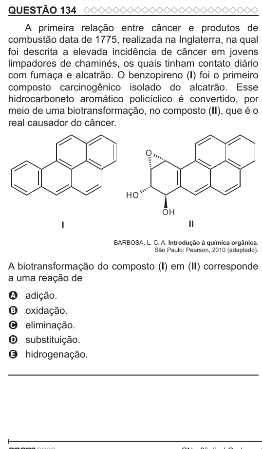

Texto extraído (pode conter ruído)

QUESTÃO 134  
A primeira relação entre câncer e produtos de  
combustão data de 1775, realizada na Inglaterra, na qual  
foi descrita a elevada incidência de câncer em jovens  
limpadores de chaminés, os quais tinham contato diário  
com fumaça e alcatrão. O benzopireno (I) foi o primeiro  
composto carcinogênico isolado do alcatrão. Esse  
hidrocarboneto aromático policíclico é convertido, por  
meio de uma biotransformação, no composto (II), que é o  
real causador do câncer.  
O  
H O  
OH  
I  
II  
BARBOSA, L. C. A. Introdução à química orgânica.  
São Paulo: Pearson, 2010 (adaptado).  
A biotransformação do composto (I) em (II) corresponde  
a uma reação de  
adição.  
A  
oxidação.  
B  
eliminação.  
C  
D  
substituição.  
hidrogenação.  
E

