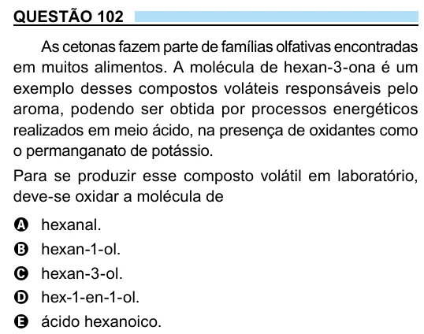

Texto extraído (pode conter ruído)

QUESTÃO 102  
As cetonas fazem parte de famílias olfativas encontradas  
em muitos alimentos. A molécula de hexan-3-ona é um  
exemplo desses compostos voláteis responsáveis pelo  
aroma, podendo ser obtida por processos energéticos  
realizados em meio ácido, na presença de oxidantes como  
o permanganato de potássio.  
Para se produzir esse composto volátil em laboratório,  
deve-se oxidar a molécula de  
A hexanal.  
B hexan-1-ol.  
C hexan-3-ol.  
D hex-1-en-1-ol.  
E ácido hexanoico.

