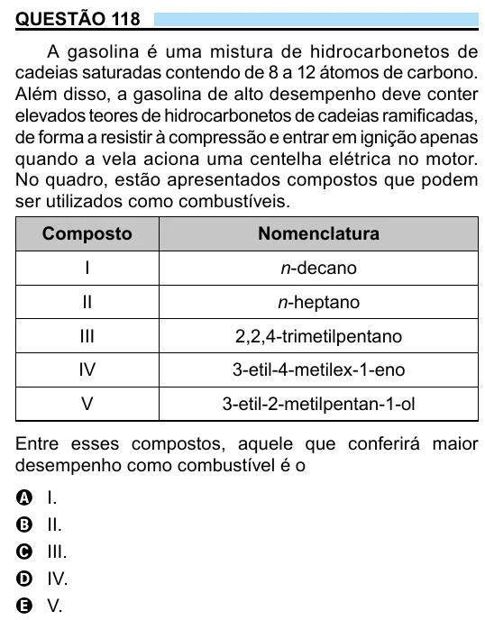

Texto extraído (pode conter ruído)

QUESTÃO 118  
A gasolina é uma mistura de hidrocarbonetos de  
cadeias saturadas contendo de 8 a 12 átomos de carbono.  
Além disso, a gasolina de alto desempenho deve conter  
elevados teores de hidrocarbonetos de cadeias ramificadas,  
de forma a resistir à compressão e entrar em ignição apenas  
quando a vela aciona uma centelha elétrica no motor.  
No quadro, estão apresentados compostos que podem  
ser utilizados como combustíveis.  
Composto  
Nomenclatura  
I  
n-decano  
II  
n-heptano  
III  
2,2,4-trimetilpentano  
IV  
3-etil-4-metilex-1-eno  
V  
3-etil-2-metilpentan-1-ol  
Entre esses compostos, aquele que conferirá maior  
desempenho como combustível é o  
A  
I.  
II.  
B  
III.  
C  
IV.  
D  
V.  
E

