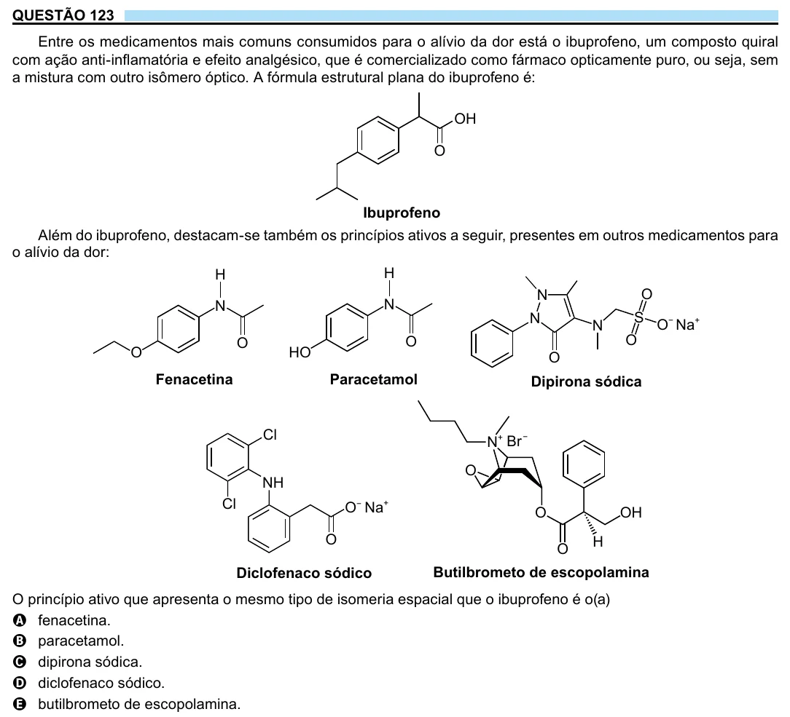

Texto extraído (pode conter ruído)

QUESTÃO 123  
Entre os medicamentos mais comuns consumidos para o alívio da dor está o ibuprofeno, um composto quiral  
com ação anti-inflamatória e efeito analgésico, que é comercializado como fármaco opticamente puro, ou seja, sem  
a mistura com outro isômero óptico. A fórmula estrutural plana do ibuprofeno é:  
OH  
O  
Ibuprofeno  
Além do ibuprofeno, destacam-se também os princípios ativos a seguir, presentes em outros medicamentos para  
o alívio da dor:  
H  
H  
N  
O  
N  
N  
N  
S  
N  
O − Na +  
O  
O  
O  
O  
HO  
O  
Fenacetina  
Paracetamol  
Dipirona sódica  
Cl  
N + Br −  
O  
NH  
Cl  
O − Na +  
O  
OH  
O  
H  
O  
Diclofenaco sódico  
Butilbrometo de escopolamina  
O princípio ativo que apresenta o mesmo tipo de isomeria espacial que o ibuprofeno é o(a)  
A fenacetina.  
B paracetamol.  
C dipirona sódica.  
D diclofenaco sódico.  
E butilbrometo de escopolamina.

