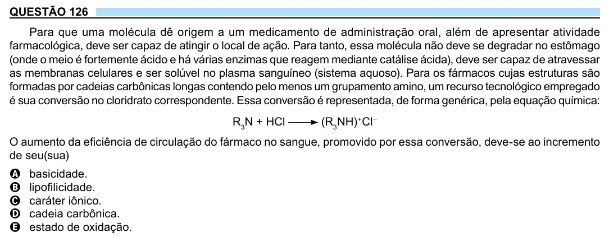

Texto extraído (pode conter ruído)

QUESTÃO 126  
Para que uma molécula dê origem a um medicamento de administração oral, além de apresentar atividade  
farmacológica, deve ser capaz de atingir o local de ação. Para tanto, essa molécula não deve se degradar no estômago  
(onde o meio é fortemente ácido e há várias enzimas que reagem mediante catálise ácida), deve ser capaz de atravessar  
as membranas celulares e ser solúvel no plasma sanguíneo (sistema aquoso). Para os fármacos cujas estruturas são  
formadas por cadeias carbônicas longas contendo pelo menos um grupamento amino, um recurso tecnológico empregado  
é sua conversão no cloridrato correspondente. Essa conversão é representada, de forma genérica, pela equação química:  
R 3 N + HCl  
(R 3 NH) + Cl –  
O aumento da eficiência de circulação do fármaco no sangue, promovido por essa conversão, deve-se ao incremento  
de seu(sua)  
basicidade.  
A  
lipofilicidade.  
B  
caráter iônico.  
C  
D  
cadeia carbônica.  
estado de oxidação.  
E

