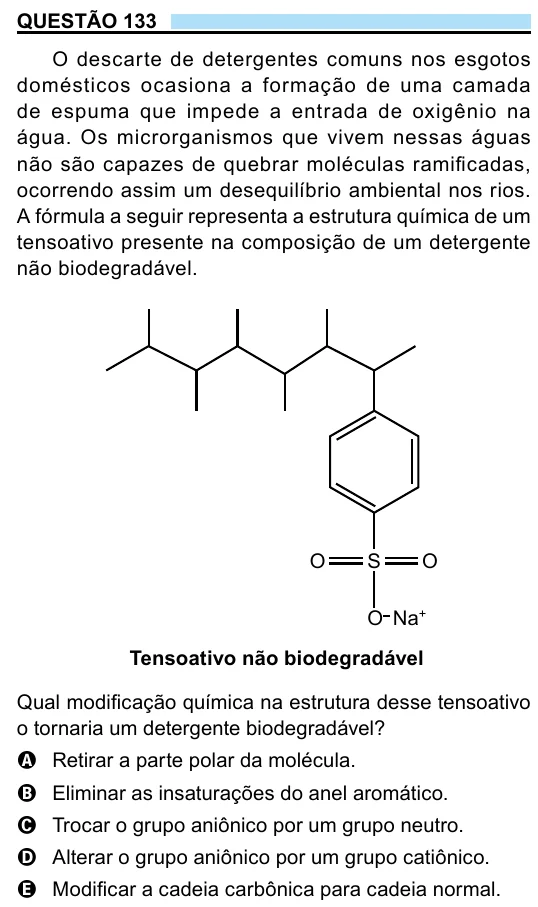

Texto extraído (pode conter ruído)

QUESTÃO 133  
O descarte de detergentes comuns nos esgotos  
domésticos ocasiona a formação de uma camada  
de espuma que impede a entrada de oxigênio na  
água. Os microrganismos que vivem nessas águas  
não são capazes de quebrar moléculas ramificadas,  
ocorrendo assim um desequilíbrio ambiental nos rios.  
A fórmula a seguir representa a estrutura química de um  
tensoativo presente na composição de um detergente  
não biodegradável.  
O  
S  
O  
O – Na +  
Tensoativo não biodegradável  
Qual modificação química na estrutura desse tensoativo  
o tornaria um detergente biodegradável?  
A Retirar a parte polar da molécula.  
B Eliminar as insaturações do anel aromático.  
C Trocar o grupo aniônico por um grupo neutro.  
D Alterar o grupo aniônico por um grupo catiônico.  
E Modificar a cadeia carbônica para cadeia normal.

