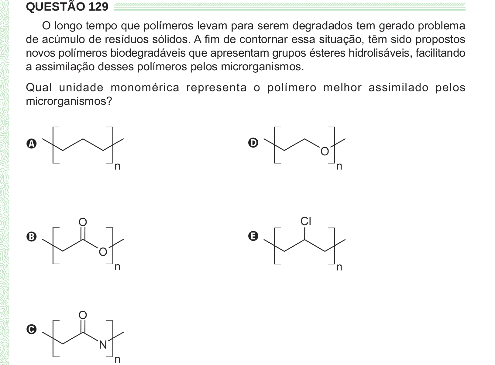

Texto extraído (pode conter ruído)

QUESTÃO 129  
O longo tempo que polímeros levam para serem degradados tem gerado problema  
de acúmulo de resíduos sólidos. A fim de contornar essa situação, têm sido propostos  
novos polímeros biodegradáveis que apresentam grupos ésteres hidrolisáveis, facilitando  
a assimilação desses polímeros pelos microrganismos.  
Qual unidade monomérica representa o polímero melhor assimilado pelos  
microrganismos?  
A  
D  
B  
E  
C

