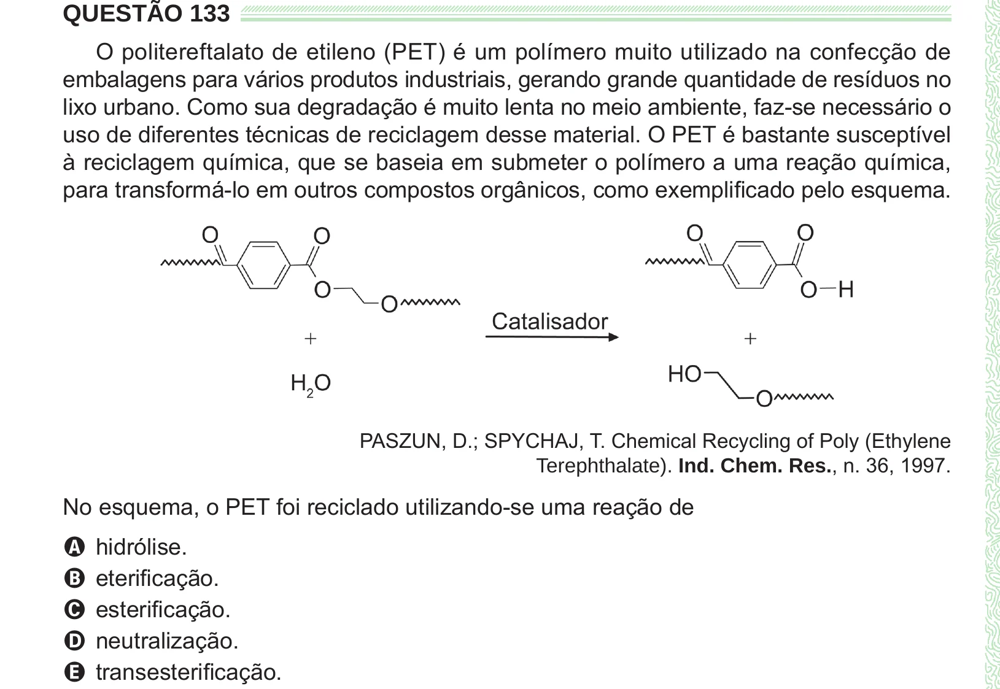

Texto extraído (pode conter ruído)

QUESTÃO 133  
O politereftalato de etileno (PET) é um polímero muito utilizado na confecção de  
embalagens para vários produtos industriais, gerando grande quantidade de resíduos no  
lixo urbano. Como sua degradação é muito lenta no meio ambiente, faz-se necessário o  
uso de diferentes técnicas de reciclagem desse material. O PET é bastante susceptível  
à reciclagem química, que se baseia em submeter o polímero a uma reação química,  
para transformá-lo em outros compostos orgânicos, como exemplificado pelo esquema.  
PASZUN, D.; SPYCHAJ, T. Chemical Recycling of Poly (Ethylene  
Terephthalate). Ind. Chem. Res., n. 36, 1997.  
No esquema, o PET foi reciclado utilizando-se uma reação de  
A hidrólise.  
B eterificação.  
C esterificação.  
D neutralização.  
E transesterificação.

