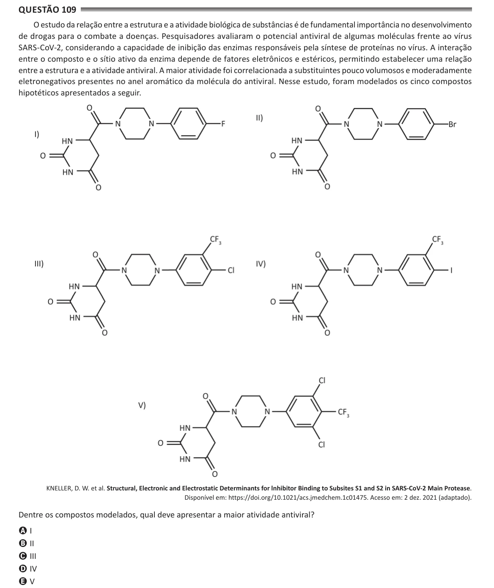

Texto extraído (pode conter ruído)

Questão 109  
O estudo da relação entre a estrutura e a atividade biológica de substâncias é de fundamental importância no desenvolvimento  
de drogas para o combate a doenças. Pesquisadores avaliaram o potencial antiviral de algumas moléculas frente ao vírus  
SARS-CoV-2, considerando a capacidade de inibição das enzimas responsáveis pela síntese de proteínas no vírus. A interação  
entre o composto e o sítio ativo da enzima depende de fatores eletrônicos e estéricos, permitindo estabelecer uma relação  
entre a estrutura e a atividade antiviral. A maior atividade foi correlacionada a substituintes pouco volumosos e moderadamente  
eletronegativos presentes no anel aromático da molécula do antiviral. Nesse estudo, foram modelados os cinco compostos  
hipotéticos apresentados a seguir.  
KNELLER, D. W. et al. Structural, Electronic and Electrostatic Determinants for lnhibitor Binding to Subsites S1 and S2 in SARS-CoV-2 Main Protease.  
Disponível em: https://doi.org/10.1021/acs.jmedchem.1c01475. Acesso em: 2 dez. 2021 (adaptado).  
Dentre os compostos modelados, qual deve apresentar a maior atividade antiviral?  
A I  
B II  
C III  
D IV  
E V

