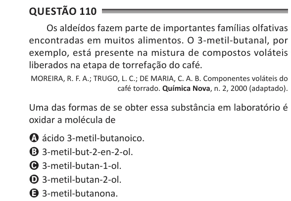

Texto extraído (pode conter ruído)

Questão 110  
Os aldeídos fazem parte de importantes famílias olfativas  
encontradas em muitos alimentos. O 3-metil-butanal, por  
exemplo, está presente na mistura de compostos voláteis  
liberados na etapa de torrefação do café.  
MOREIRA, R. F. A.; TRUGO, L. C.; DE MARIA, C. A. B. Componentes voláteis do  
café torrado. Química Nova, n. 2, 2000 (adaptado).  
Uma das formas de se obter essa substância em laboratório é  
oxidar a molécula de  
A ácido 3-metil-butanoico.  
B 3-metil-but-2-en-2-ol.  
C 3-metil-butan-1-ol.  
D 3-metil-butan-2-ol.  
E 3-metil-butanona.

