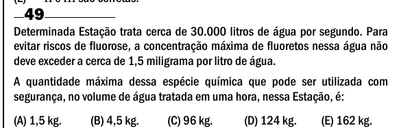

Texto extraído (pode conter ruído)

49  
Determinada Estação trata cerca de 30.000 litros de água por segundo. Para  
evitar riscos de fluorose, a concentração máxima de fluoretos nessa água não  
deve exceder a cerca de 1,5 miligrama por litro de água.  
A quantidade máxima dessa espécie química que pode ser utilizada com  
segurança, no volume de água tratada em uma hora, nessa Estação, é:  
(A) 1,5 kg.  
(B) 4,5 kg.  
(C) 96 kg.  
(D) 124 kg.  
(E) 162 kg.

