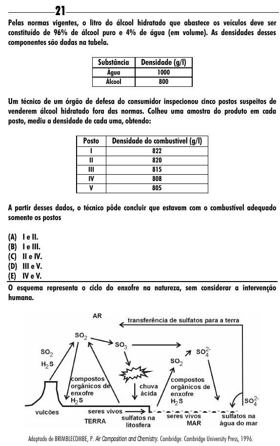

Texto extraído (pode conter ruído)

21  
Pelas normas vigentes, o litro do álcool hidratado que abastece os veículos deve ser  
constituído de 96% de álcool puro e 4% de água (em volume). As densidades desses  
componentes são dadas na tabela.  
Substância  
Densidade (g/l)  
Água  
1000  
Álcool  
800  
Um técnico de um órgão de defesa do consumidor inspecionou cinco postos suspeitos de  
venderem álcool hidratado fora das normas. Colheu uma amostra do produto em cada  
posto, mediu a densidade de cada uma, obtendo:  
Posto  
Densidade do combustível (g/l)  
I  
822  
II  
820  
III  
815  
IV  
808  
V  
805  
A partir desses dados, o técnico pôde concluir que estavam com o combustível adequado  
somente os postos  
(A) I e II.  
(B) I e III.  
(C) II e IV.  
(D) III e V.  
(E) IV e V.  
O esquema representa o ciclo do enxofre na natureza, sem considerar a intervenção  
humana.  
Adaptado de BRIMBLECOMBE, P. Air Composition and Chemistry. Cambridge. Cambridge University Press, 1996.

