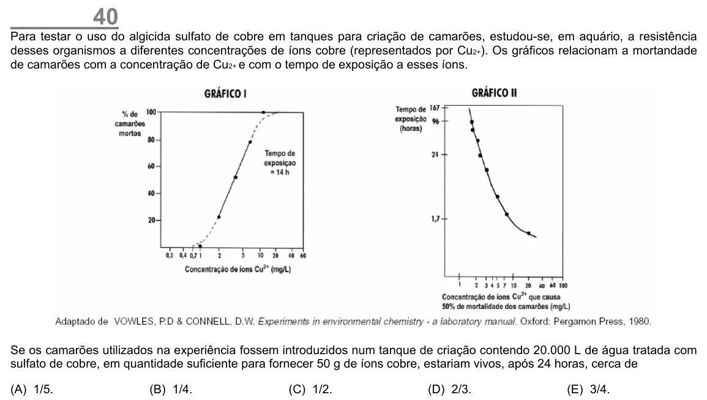

Texto extraído (pode conter ruído)

40  
Para testar o uso do algicida sulfato de cobre em tanques para criação de camarões, estudou-se, em aquário, a resistência  
desses organismos a diferentes concentrações de íons cobre (representados por Cu 2+ ). Os gráficos relacionam a mortandade  
de camarões com a concentração de Cu 2+ e com o tempo de exposição a esses íons.  
Se os camarões utilizados na experiência fossem introduzidos num tanque de criação contendo 20.000 L de água tratada com  
sulfato de cobre, em quantidade suficiente para fornecer 50 g de íons cobre, estariam vivos, após 24 horas, cerca de  
(A) 1/5.  
(B) 1/4.  
(C) 1/2.  
(D) 2/3.  
(E) 3/4.

