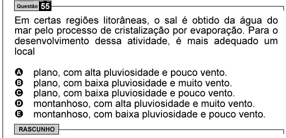

Texto extraído (pode conter ruído)

Questão 55  
Em certas regiões litorâneas, o sal é obtido da água do  
mar pelo processo de cristalização por evaporação. Para o  
desenvolvimento dessa atividade, é mais adequado um  
local  
A  
plano, com alta pluviosidade e pouco vento.  
B  
plano, com baixa pluviosidade e muito vento.  
C  
plano, com baixa pluviosidade e pouco vento.  
D  
montanhoso, com alta pluviosidade e muito vento.  
E  
montanhoso, com baixa pluviosidade e pouco vento.  
RASCUNHO

