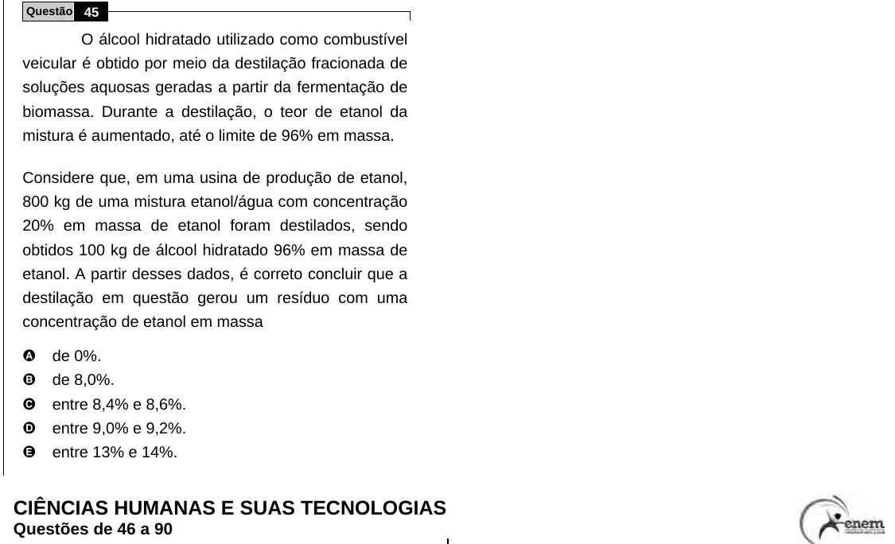

Texto extraído (pode conter ruído)

Questão 45  
O álcool hidratado utilizado como combustível  
veicular é obtido por meio da destilação fracionada de  
soluções aquosas geradas a partir da fermentação de  
biomassa. Durante a destilação, o teor de etanol da  
mistura é aumentado, até o limite de 96% em massa.  
Considere que, em uma usina de produção de etanol,  
800 kg de uma mistura etanol/água com concentração  
20% em massa de etanol foram destilados, sendo  
obtidos 100 kg de álcool hidratado 96% em massa de  
etanol. A partir desses dados, é correto concluir que a  
destilação em questão gerou um resíduo com uma  
concentração de etanol em massa  
A  
de 0%.  
B  
de 8,0%.  
C  
entre 8,4% e 8,6%.  
D  
entre 9,0% e 9,2%.  
E  
entre 13% e 14%.  
CIÊNCIAS HUMANAS E SUAS TECNOLOGIAS  
Questões de 46 a 90

