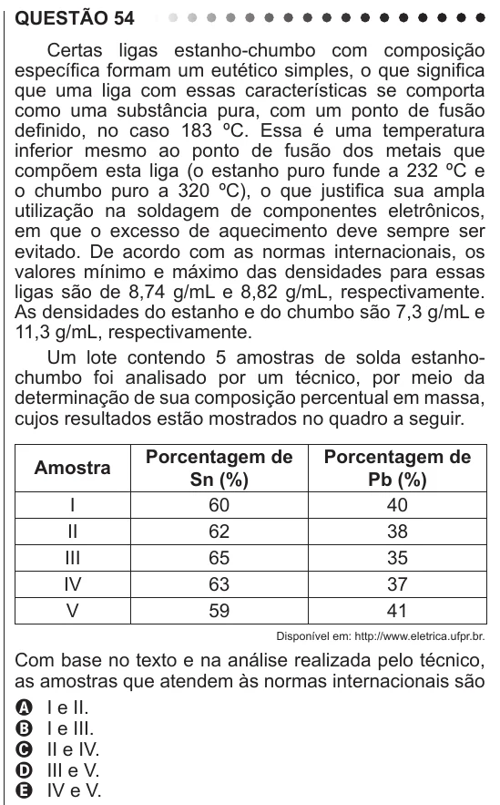

Texto extraído (pode conter ruído)

QUESTÃO 54  
Certas ligas estanho-chumbo com composição  
específica formam um eutético simples, o que significa  
que uma liga com essas características se comporta  
como uma substância pura, com um ponto de fusão  
definido, no caso 183 ºC. Essa é uma temperatura  
inferior mesmo ao ponto de fusão dos metais que  
compõem esta liga (o estanho puro funde a 232 ºC e  
o chumbo puro a 320 ºC), o que justifica sua ampla  
utilização na soldagem de componentes eletrônicos,  
em que o excesso de aquecimento deve sempre ser  
evitado. De acordo com as normas internacionais, os  
valores mínimo e máximo das densidades para essas  
ligas são de 8,74 g/mL e 8,82 g/mL, respectivamente.  
As densidades do estanho e do chumbo são 7,3 g/mL e  
11,3 g/mL, respectivamente.  
Um lote contendo 5 amostras de solda estanho-  
chumbo foi analisado por um técnico, por meio da  
determinação de sua composição percentual em massa,  
cujos resultados estão mostrados no quadro a seguir.  
Porcentagem de  
Porcentagem de  
Amostra  
Sn (%)  
Pb (%)  
I  
60  
40  
II  
62  
38  
III  
65  
35  
IV  
63  
37  
V  
59  
41  
Disponível em: http://www.eletrica.ufpr.br.  
Com base no texto e na análise realizada pelo técnico,  
as amostras que atendem às normas internacionais são  
A I e II.  
B I e III.  
C II e IV.  
D III e V.  
E IV e V.

