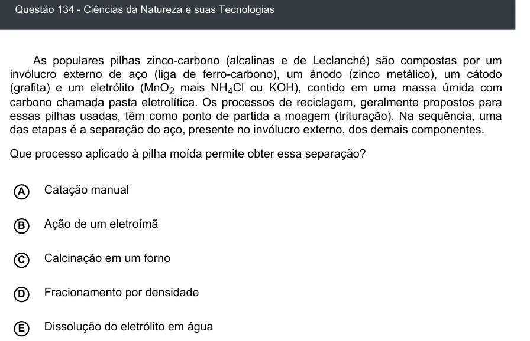

Texto extraído (pode conter ruído)

Questão 134 - Ciências da Natureza e suas Tecnologias  
As populares pilhas zinco-carbono (alcalinas e de Leclanché) são compostas por um  
invólucro externo de aço (liga de ferro-carbono), um ânodo (zinco metálico), um cátodo  
(grafita) e um eletrólito (MnO 2 mais NH 4 Cl ou KOH), contido em uma massa úmida com  
carbono chamada pasta eletrolítica. Os processos de reciclagem, geralmente propostos para  
essas pilhas usadas, têm como ponto de partida a moagem (trituração). Na sequência, uma  
das etapas é a separação do aço, presente no invólucro externo, dos demais componentes.  
Que processo aplicado à pilha moída permite obter essa separação?  
A  
Catação manual  
Ação de um eletroímã  
B  
Calcinação em um forno  
C  
D  
Fracionamento por densidade  
Dissolução do eletrólito em água  
E

