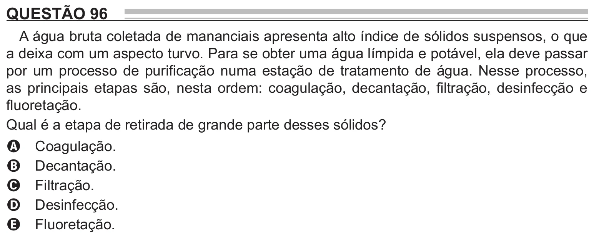

Texto extraído (pode conter ruído)

QUESTÃO 96  
A água bruta coletada de mananciais apresenta alto índice de sólidos suspensos, o que  
a deixa com um aspecto turvo. Para se obter uma água límpida e potável, ela deve passar  
por um processo de purificação numa estação de tratamento de água. Nesse processo,  
as principais etapas são, nesta ordem: coagulação, decantação, filtração, desinfecção e  
fluoretação.  
Qual é a etapa de retirada de grande parte desses sólidos?  
Coagulação.  
A  
Decantação.  
B  
Filtração.  
C  
Desinfecção.  
D  
Fluoretação.  
E

