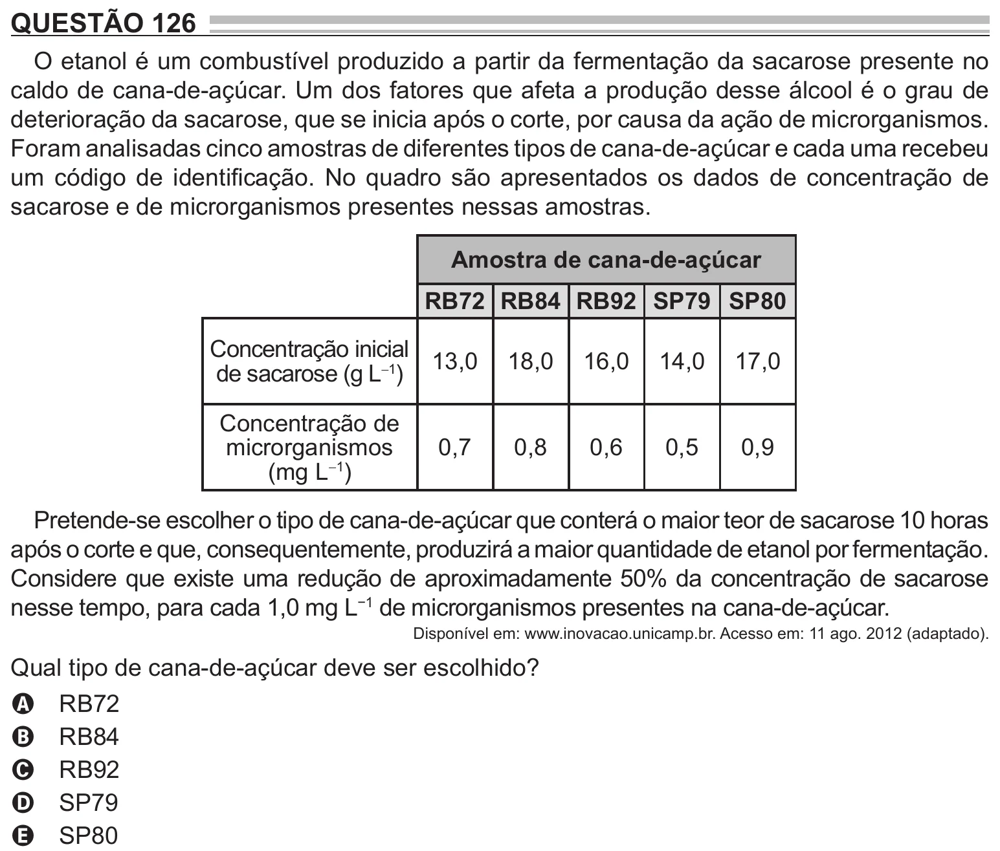

Texto extraído (pode conter ruído)

QUESTÃO 126  
O etanol é um combustível produzido a partir da fermentação da sacarose presente no  
caldo de cana-de-açúcar. Um dos fatores que afeta a produção desse álcool é o grau de  
deterioração da sacarose, que se inicia após o corte, por causa da ação de microrganismos.  
Foram analisadas cinco amostras de diferentes tipos de cana-de-açúcar e cada uma recebeu  
um código de identificação. No quadro são apresentados os dados de concentração de  
sacarose e de microrganismos presentes nessas amostras.  
Amostra de cana-de-açúcar  
RB72 RB84 RB92 SP79 SP80  
Concentração inicial  
13,0  
18,0  
16,0  
14,0  
17,0  
de sacarose (g L -1 )  
Concentração de  
microrganismos  
0,7  
0,8  
0,6  
0,5  
0,9  
(mg L -1 )  
Pretende-se escolher o tipo de cana-de-açúcar que conterá o maior teor de sacarose 10 horas  
após o corte e que, consequentemente, produzirá a maior quantidade de etanol por fermentação.  
Considere que existe uma redução de aproximadamente 50% da concentração de sacarose  
nesse tempo, para cada 1,0 mg L −1 de microrganismos presentes na cana-de-açúcar.  
Disponível em: www.inovacao.unicamp.br. Acesso em: 11 ago. 2012 (adaptado).  
Qual tipo de cana-de-açúcar deve ser escolhido?  
RB72  
A  
RB84  
B  
RB92  
C  
SP79  
D  
SP80  
E

