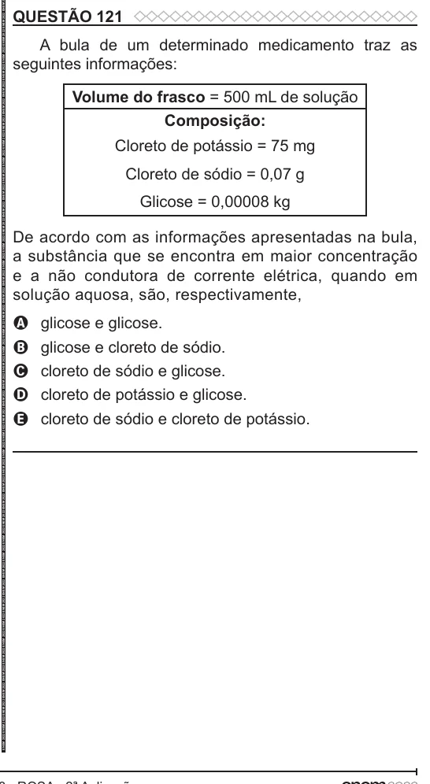

Texto extraído (pode conter ruído)

QUESTÃO 121  
A bula de um determinado medicamento traz as  
seguintes informações:  
Volume do frasco = 500 mL de solução  
Composição:  
Cloreto de potássio = 75 mg  
Cloreto de sódio = 0,07 g  
Glicose = 0,00008 kg  
De acordo com as informações apresentadas na bula,  
a substância que se encontra em maior concentração  
e a não condutora de corrente elétrica, quando em  
solução aquosa, são, respectivamente,  
glicose e glicose.  
A  
glicose e cloreto de sódio.  
B  
C  
cloreto de sódio e glicose.  
cloreto de potássio e glicose.  
D  
cloreto de sódio e cloreto de potássio.  
E

