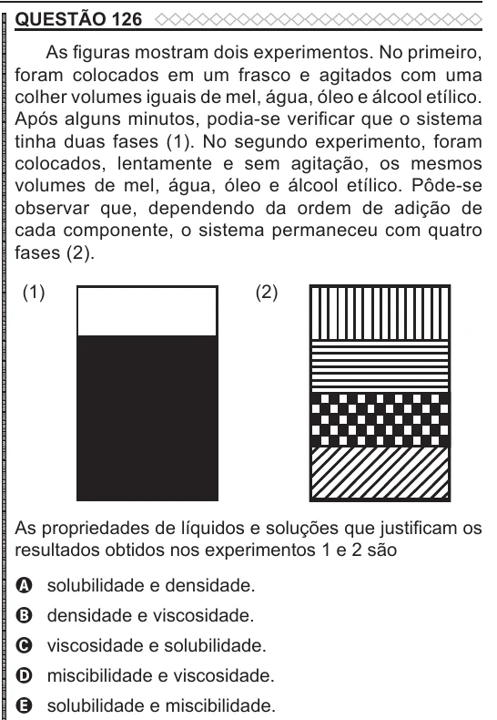

Texto extraído (pode conter ruído)

QUESTÃO 126  
As figuras mostram dois experimentos. No primeiro,  
foram colocados em um frasco e agitados com uma  
colher volumes iguais de mel, água, óleo e álcool etílico.  
Após alguns minutos, podia-se verificar que o sistema  
tinha duas fases (1). No segundo experimento, foram  
colocados, lentamente e sem agitação, os mesmos  
volumes de mel, água, óleo e álcool etílico. Pôde-se  
observar que, dependendo da ordem de adição de  
cada componente, o sistema permaneceu com quatro  
fases (2).  
(1)  
(2)  
As propriedades de líquidos e soluções que justificam os  
resultados obtidos nos experimentos 1 e 2 são  
A solubilidade e densidade.  
B densidade e viscosidade.  
C viscosidade e solubilidade.  
D miscibilidade e viscosidade.  
E solubilidade e miscibilidade.

