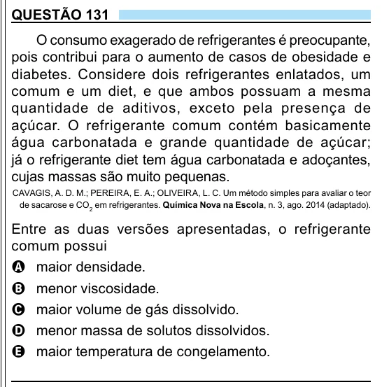

Texto extraído (pode conter ruído)

QUESTÃO 131  
O consumo exagerado de refrigerantes é preocupante,  
pois contribui para o aumento de casos de obesidade e  
diabetes. Considere dois refrigerantes enlatados, um  
comum e um diet, e que ambos possuam a mesma  
quantidade de aditivos, exceto pela presença de  
açúcar. O refrigerante comum contém basicamente  
água carbonatada e grande quantidade de açúcar;  
já o refrigerante diet tem água carbonatada e adoçantes,  
cujas massas são muito pequenas.  
CAVAGIS, A. D. M.; PEREIRA, E. A.; OLIVEIRA, L. C. Um método simples para avaliar o teor  
de sacarose e CO 2 em refrigerantes. Química Nova na Escola, n. 3, ago. 2014 (adaptado).  
Entre as duas versões apresentadas, o refrigerante  
comum possui  
A maior densidade.  
B menor viscosidade.  
C maior volume de gás dissolvido.  
D menor massa de solutos dissolvidos.  
E maior temperatura de congelamento.  
13

