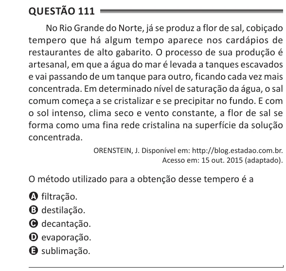

Texto extraído (pode conter ruído)

Questão 111  
No Rio Grande do Norte, já se produz a flor de sal, cobiçado  
tempero que há algum tempo aparece nos cardápios de  
restaurantes de alto gabarito. O processo de sua produção é  
artesanal, em que a água do mar é levada a tanques escavados  
e vai passando de um tanque para outro, ficando cada vez mais  
concentrada. Em determinado nível de saturação da água, o sal  
comum começa a se cristalizar e se precipitar no fundo. E com  
o sol intenso, clima seco e vento constante, a flor de sal se  
forma como uma fina rede cristalina na superfície da solução  
concentrada.  
ORENSTEIN, J. Disponível em: http://blog.estadao.com.br.  
Acesso em: 15 out. 2015 (adaptado).  
O método utilizado para a obtenção desse tempero é a  
A filtração.  
B destilação.  
C decantação.  
D evaporação.  
E sublimação.

