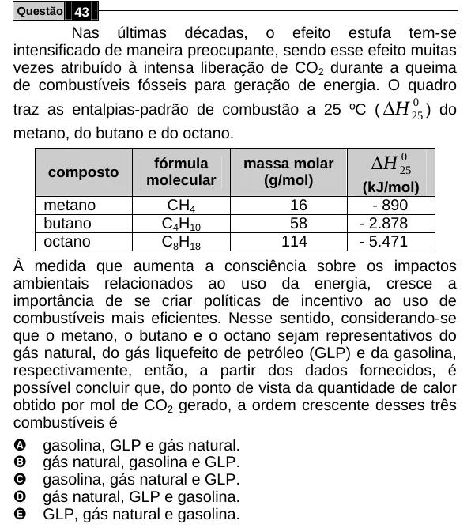

Texto extraído (pode conter ruído)

Questão 43  
Nas últimas décadas, o efeito estufa tem-se  
intensificado de maneira preocupante, sendo esse efeito muitas  
vezes atribuído à intensa liberação de CO 2 durante a queima  
de combustíveis fósseis para geração de energia. O quadro  
traz as entalpias-padrão de combustão a 25 ºC ( Δ H 25 ) do  
0  
metano, do butano e do octano.  
Δ H  
0  
fórmula  
massa molar  
composto  
25  
molecular  
(g/mol)  
(kJ/mol)  
metano  
CH 4  
16  
- 890  
butano  
C 4 H 10  
58  
- 2.878  
octano  
C 8 H 18  
114  
- 5.471  
À medida que aumenta a consciência sobre os impactos  
ambientais relacionados ao uso da energia, cresce a  
importância de se criar políticas de incentivo ao uso de  
combustíveis mais eficientes. Nesse sentido, considerando-se  
que o metano, o butano e o octano sejam representativos do  
gás natural, do gás liquefeito de petróleo (GLP) e da gasolina,  
respectivamente, então, a partir dos dados fornecidos, é  
possível concluir que, do ponto de vista da quantidade de calor  
obtido por mol de CO 2 gerado, a ordem crescente desses três  
combustíveis é  
A gasolina, GLP e gás natural.  
B gás natural, gasolina e GLP.  
C gasolina, gás natural e GLP.  
D gás natural, GLP e gasolina.  
E GLP, gás natural e gasolina.

