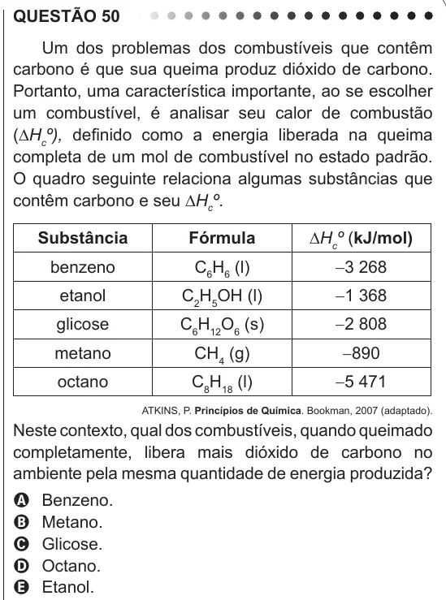

Texto extraído (pode conter ruído)

QUESTÃO 50  
Um dos problemas dos combustíveis que contêm  
carbono é que sua queima produz dióxido de carbono.  
Portanto, uma característica importante, ao se escolher  
um combustível, é analisar seu calor de combustão  
(∆H c º), definido como a energia liberada na queima  
completa de um mol de combustível no estado padrão.  
O quadro seguinte relaciona algumas substâncias que  
contêm carbono e seu ∆H c º.  
Substância  
Fórmula  
∆H c º (kJ/mol)  
benzeno  
C 6 H 6 (l)  
-3 268  
etanol  
C 2 H 5 OH (l)  
-1 368  
glicose  
C 6 H 12 O 6 (s)  
-2 808  
metano  
CH 4 (g)  
-890  
octano  
C 8 H 18 (l)  
-5 471  
ATKINS, P. Princípios de Química. Bookman, 2007 (adaptado).  
Neste contexto, qual dos combustíveis, quando queimado  
completamente, libera mais dióxido de carbono no  
ambiente pela mesma quantidade de energia produzida?  
A  
Benzeno.  
Metano.  
B  
Glicose.  
C  
D  
Octano.  
Etanol.  
E

