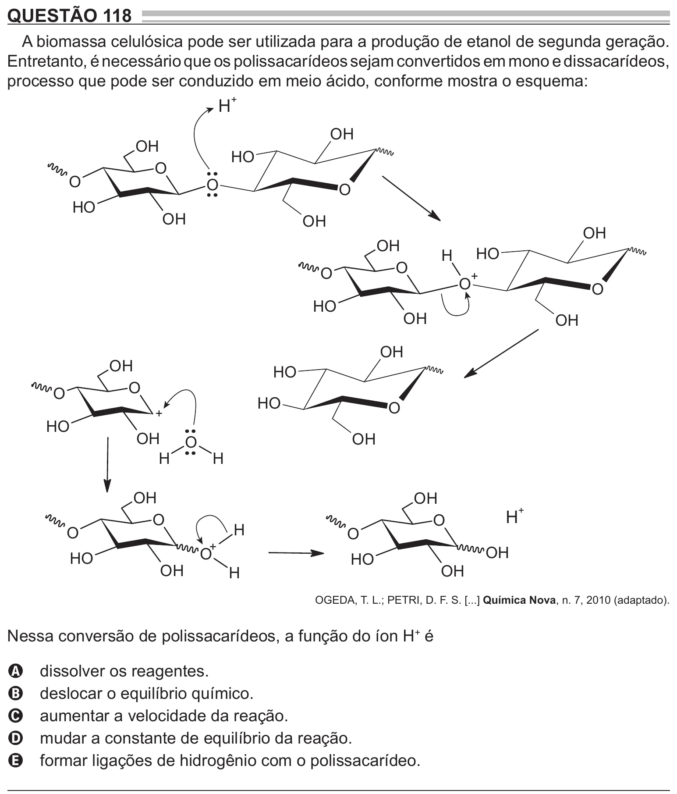

Texto extraído (pode conter ruído)

QUESTÃO 118  
A biomassa celulósica pode ser utilizada para a produção de etanol de segunda geração.  
Entretanto, é necessário que os polissacarídeos sejam convertidos em mono e dissacarídeos,  
processo que pode ser conduzido em meio ácido, conforme mostra o esquema:  
H  
+  
OH  
OH  
H O  
O  
O  
O  
O  
H O  
OH  
OH  
OH  
OH  
H O  
H  
O  
+  
O  
+  
O  
O  
H O  
OH  
OH  
OH  
OH  
H O  
O  
O  
H O  
O  
+  
H O  
OH  
OH  
O  
H  
H  
OH  
OH  
H  
+  
O  
O  
H  
O  
O  
+  
OH  
O  
H O  
H O  
OH  
OH  
H  
OGEDA, T. L.; PETRI, D. F. S. [...] Química Nova, n. 7, 2010 (adaptado).  
Nessa conversão de polissacarídeos, a função do íon H + é  
dissolver os reagentes.  
A  
deslocar o equilíbrio químico.  
B  
aumentar a velocidade da reação.  
C  
mudar a constante de equilíbrio da reação.  
D  
formar ligações de hidrogênio com o polissacarídeo.  
E

